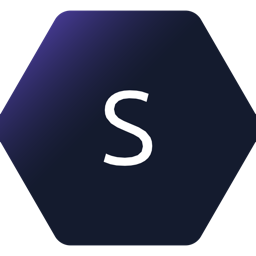

<p align="center">
  
</p>

<h1 align="center">scry</h1>

<p align="center">
  A fast, cross-platform <b>Windows&nbsp;365 / Azure Virtual Desktop</b> Cloud&nbsp;PC client<br>
  that you — and an AI agent — can see and drive.
</p>

<p align="center">
  
  
  
  
</p>

---

It signs in with Entra ID, connects through the AVD gateway, and shows the remote desktop in a native
window — while exposing the same session to an agent over the **Model Context Protocol (MCP)**. Think
of it as a remote-desktop client with a built-in automation seam: you watch and take over in the
viewer; an agent clicks, types, scrolls and reads the screen through MCP. Written in Rust on top of
[IronRDP](https://github.com/Devolutions/IronRDP).

## Highlights

- **One sign-in, native viewer.** Entra ID sign-in in an embedded window (macOS/Windows) or the
  system browser (Linux); GPU-rendered viewer with the real remote cursor, dynamic resolution
  (resize / fullscreen), and text clipboard where the tenant allows it.
- **Agent control over MCP.** A local MCP server lets an AI take screenshots and drive mouse and
  keyboard. An on-screen banner shows when the agent is acting, with **Pause / Stop**, and your own
  input instantly takes over.
- **Desktop app or CLI.** Double-click launcher (sign in, pick a Cloud PC, connect) or scriptable
  subcommands.
- **Graphics you choose.** *Sharp* (lossless RemoteFX, crispest text) or *Fast* (H.264, far less
  bandwidth) per connection.

## Quick start

Prebuilt binaries for macOS, Windows and Linux are attached to each
[release](../../releases). Or build it yourself (Rust 1.94+ — see
[docs/BUILDING.md](docs/BUILDING.md) for system packages):

```sh
cargo build --release
```

> Releases are cut by pushing a tag: `git tag v0.1.0 && git push --tags`.

### Desktop app (macOS)

```sh
scripts/make-macos-app.sh      # → dist/scry.app
open dist/scry.app             # or drag into /Applications
```

Running `scry` with **no subcommand** (what a double-click does) opens the launcher: it signs you
in, lists your Cloud PC(s), and opens the viewer on **Connect**. On Windows, run `scry.exe` with no
arguments for the same launcher.

### CLI

```sh
scry login                     # sign in, store a refresh token
scry list                      # list entitled Cloud PCs (prints an index per machine)
scry session 0 --viewer        # connect to index 0: viewer + agent control + local API
```

| Command | What it does |
|---|---|
| `login` | Sign in with Entra ID and cache the refresh token. |
| `list` | List the Cloud PCs the account is entitled to, with an index. |
| `connect <i> [-o out.png] [-s secs]` | Connect once and save a screenshot to a PNG. |
| `session <i> [--viewer] [--port 7878] [--mcp-port 7879]` | Stay connected: optional viewer window, a local control API (`:7878`) and the MCP server (`:7879`). |

## Agent control (MCP)

While a `session` is running, scry serves an MCP endpoint on `http://127.0.0.1:7879/mcp`.

Add it to Claude Code (the launcher's **Agent access** card copies this for you):

```sh
claude mcp add --transport http scry http://127.0.0.1:7879/mcp
```

Or any MCP client, as a streamable-HTTP server at that URL.

### Tools

| Tool | Purpose |
|---|---|
| `screenshot` | Capture the current screen as a PNG (≤ 1280 px wide; coordinates are in this image). |
| `click` | Move to `(x, y)` and click (`button`, `double` optional). |
| `move_mouse` | Move the pointer without clicking. |
| `scroll` | Turn the wheel at `(x, y)`. |
| `type_text` | Type text (≈ 18 chars/s; `\n` presses Enter). |
| `paste_text` | Paste text instantly via the clipboard (falls back to typing if clipboard is disabled). |
| `key` | Press a key or combo, e.g. `win+r`, `ctrl+shift+esc`, `alt+f4`. |
| `get_clipboard` | Read the text last copied on the Cloud PC. |

All coordinates refer to the most recent `screenshot`. The server tells the agent to screenshot
after each action and check the result before continuing.

### Human takeover

When the agent is acting, a banner appears at the top of the viewer with a progress line and
**Pause** / **Stop**. Moving your own mouse or typing auto-pauses the agent; **Stop** refuses further
agent actions until you click **Allow agent**.

## Typical use

- **Watch an agent work.** Open the viewer, hand the MCP server to Claude Code, and ask it to do a
  task in the Cloud PC — filling a form, navigating an internal tool, pulling data from a desktop
  app — while you watch and step in if needed.
- **Everyday remote desktop.** Use it as a plain, fast Cloud PC viewer: sign in, connect, work. Pick
  *Sharp* for crisp text or *Fast* on a weak connection.
- **Scripted / headless.** `scry session 0` (no `--viewer`) runs the agent + control API without a
  window — e.g. on a box driving the Cloud PC from automation.
- **One-shot capture.** `scry connect 0 -o shot.png` grabs a single screenshot.

## Graphics modes

Set per connection from the launcher toggle, or `SCRY_GRAPHICS` for the CLI:

- `rfx` (**Sharp**, default) — lossless RemoteFX; sharpest text, more bandwidth.
- `h264` (**Fast**) — H.264/AVC420; smooth motion and much lower bandwidth, slightly softer text.

On a motion-heavy benchmark, Fast cut bandwidth ~17× (to roughly match the official client) for a
modest CPU/memory cost. See [bench/](bench/) for the workload and a local measurement script.

## How it works

Entra ID sign-in (auth-code + PKCE) → AVD feed discovery (download the `.rdp`) → a WebSocket to the
AVD gateway → Entra SSO into the session host (RDSAAD) → an RDP session decoded by IronRDP. The
viewer renders the framebuffer on the GPU (`pixels`/wgpu); the launcher is `egui`; the embedded
sign-in uses a WebView (`wry`). The protocol details were ported with reference to IronRDP and
FreeRDP.

## Security notes

- The control (`:7878`) and MCP (`:7879`) ports listen on `127.0.0.1` only, but have no auth yet —
  any local process can use them while a session is open. Adding a token is on the backlog.
- The inner TLS to the session host isn't certificate-pinned yet (the gateway hop is fully
  verified). Pinning is on the backlog.
- Sign-in tokens are stored in the OS data dir with `0600` permissions.

Use scry only against machines and accounts you are authorized to access, and follow your
organization's policies.

## Status

macOS, Windows and Linux build in CI. The GUI launcher is `egui` (no GTK); the embedded sign-in is
macOS/Windows (Linux falls back to the browser). See [docs/BACKLOG.md](docs/BACKLOG.md) for what's
next (hardware H.264 decode, auto-reconnect, cert pinning, port auth).

## Acknowledgements

Built on [IronRDP](https://github.com/Devolutions/IronRDP) (the Rust RDP stack), with the gateway and
Entra sign-in flows implemented with reference to [FreeRDP](https://github.com/FreeRDP/FreeRDP). UI
and rendering use [egui](https://github.com/emilk/egui), [pixels](https://github.com/parasyte/pixels)
/ [wgpu](https://github.com/gfx-rs/wgpu) and [wry](https://github.com/tauri-apps/wry).

## License

[MIT](LICENSE).
